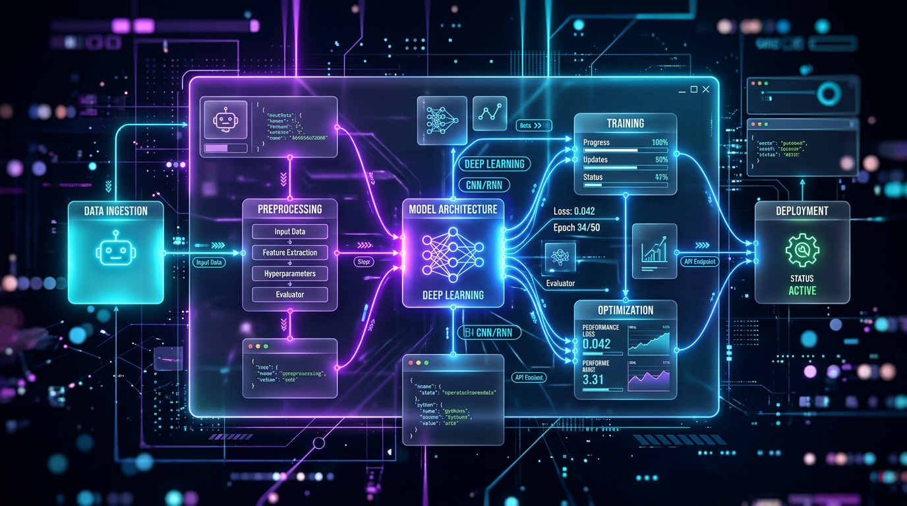

# 🌌 AetherFlow Studio

> **Visual Autonomous Agent & AI Workflow Orchestration Canvas**  
> *Design, simulate, and export multi-agent AI pipelines with interactive bezier wiring, native Web Audio feedback, real-time DAG execution telemetry, and instant Python/TypeScript code generation.*

[](https://0612divyansh.github.io/aetherflow-studio/)
[](https://github.com/0612divyansh/aetherflow-studio)
[](LICENSE)
[](#features)

---



---

## ⚡ Highlights & Innovations

AetherFlow Studio is built for AI engineers, autonomous agent developers, and builders who want to visually construct, debug, and prototype complex DAG workflows without heavy desktop dependencies or cumbersome cloud subscriptions.

- 🎛️ **Infinite Canvas & Bezier Graph Engine**: Fluid zoom, pan, snap-to-grid, minimap radar, and dynamic cubic bezier cables that pulse with animated data particles during execution.
- 🔊 **Native Web Audio Synthesizer**: Zero external audio files. Generates harmonic sine/triangle chord arpeggios, frequency chirps on connect/disconnect, and execution alerts in pure browser Web Audio API.
- ⚡ **Real-Time DAG Execution Simulator**: Traverses topological execution orders, simulates network latency, streams token usage, calculates pricing, and outputs live JSON payloads for each node.
- 🐍 **Production Code Generator**: Instantly generates clean, executable Python (`LangChain` / `asyncio`) and TypeScript orchestration scripts.
- 📦 **Zero External Runtime Dependencies**: Vanilla HTML5, CSS3, and JavaScript — no build steps, instant load, 100/100 Lighthouse performance, completely client-side and privacy-preserving.
- 💾 **Full Local Persistence & Export**: Auto-saves every modification to `localStorage`, with 1-click JSON project export/import and high-resolution PNG snapshot generator.

---

## 🧩 Node Library

| Category | Node | Description |
| :--- | :--- | :--- |
| **Autonomous Agents** | `LLM Synthesizer` | Multi-model prompt orchestration (`Gemini 1.5`, `Claude 3.5`, `GPT-4o`, `Llama 3.3`) |
| **Autonomous Agents** | `Intent Classifier` | Semantic routing, urgency detection, and sentiment scoring |
| **Triggers** | `Webhook Trigger` | REST API inbound listener with bearer/HMAC authentication |
| **Triggers** | `Web Scraper` | Live DOM and markdown content extraction |
| **Triggers** | `Cron Schedule` | Scheduled recurring DAG invocations |
| **Logic & Context** | `Condition Branch` | True/False boolean expression evaluation with dual output sockets |
| **Logic & Context** | `Vector Memory` | RAG semantic vector similarity search with Top-K filters |
| **Logic & Context** | `Python / JS Runner` | Custom in-line transformation logic |
| **Actions** | `Slack / Discord Alert` | Rich card notifications and incident escalation |
| **Actions** | `GitHub PR / Issue` | Automated branch creation, code patching, and issue generation |

---

## 🚀 Pre-Loaded Showcase Templates

1. 🛡️ **Autonomous SecOps Auditor Pipeline**  
   *Webhook (GitHub Push) → LLM Auditor (AST & Secrets) → Condition Branch → GitHub Action (Open Auto-Patch PR) + Slack Security Dispatch.*

2. 📈 **Growth & Lead Enrichment Engine**  
   *Inbound Lead Webhook → Web Scraper (Domain enrichment) → Claude 3.5 Sonnet (ICP scoring) → Condition Branch → #enterprise-deals Slack alert.*

3. 📰 **Deep Tech & AI Research Synthesizer**  
   *Cron (Daily 06:00 UTC) → ArXiv Paper Scraper → Vector Memory Store → GPT-4o Executive Digest → Slack Engineering Digest.*

4. 💬 **Customer Support Auto-Pilot & Escalation**  
   *Inbound Support Email → Sentiment Classifier → Condition Router → P1 VP Escalation OR Automated Helpful AI Response.*

---

## ⌨️ Keyboard Shortcuts

| Shortcut | Action |
| :--- | :--- |
| <kbd>⌘ K</kbd> or <kbd>Ctrl K</kbd> | Open Command Palette (instant node lookup & quick actions) |
| <kbd>Space</kbd> | Run / Simulate Workflow Pipeline |
| <kbd>Delete</kbd> / <kbd>Backspace</kbd> | Delete selected node |
| <kbd>Mouse Wheel</kbd> | Smooth canvas zoom in / out |
| <kbd>Click + Drag Wire</kbd> | Connect output port to input port |
| <kbd>Click Existing Wire</kbd> | Disconnect / remove wire |

---

## 🛠️ Quick Local Setup

No `npm install`, node modules, or build configurations required.

```bash
# Clone the repository
git clone git@github.com:0612divyansh/aetherflow-studio.git
cd aetherflow-studio

# Open in your browser
open index.html
```

Or serve with Python:
```bash
python3 -m http.server 3000
# Open http://localhost:3000
```

---

## 🌐 Deployment

### GitHub Pages (Included Workflow)
The repository contains `.github/workflows/deploy.yml`. When pushed to GitHub, GitHub Actions deploys the application automatically to GitHub Pages at:
`https://0612divyansh.github.io/aetherflow-studio/`

### Vercel / Netlify
Includes `vercel.json`. Simply import the repository in [vercel.com](https://vercel.com) for zero-config global Edge CDN hosting.

---

## 👤 Author

**Divyansh Shandil**  
- GitHub: [@0612divyansh](https://github.com/0612divyansh)  
- Portfolio: [0612divyansh.github.io](https://0612divyansh.github.io)

*Built as part of the 4-Day Project Launchpad initiative.*
